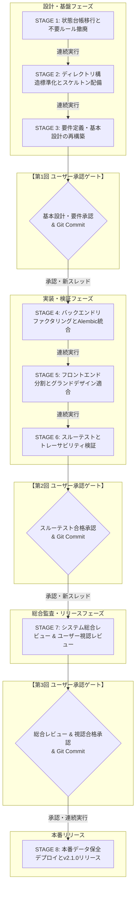

# bicycle-log v2.1.0 全面改訂基本計画書

- **プロジェクト名**: bicycle-log
- **対象バージョン**: v1.2 ➔ v2.1.0
- **策定日**: 2026-10-28
- **統括責任者**: 👑 プロジェクトコンダクター (`conductor`)
- **準拠規約**: AI駆動システム開発プロセス標準規約 (System Dev Pipeline Rule V2.6)
- **展開プロファイル**: Profile A (クラウド公開型 / Cloud Run + SQLite WAL + Alembic + Litestream + React SPA)

---

## 1. 改訂の背景と重点目標

開発支援パイプライン `system-dev-pipeline` が V2.6 へアップグレードされたことに伴い、現行 `bicycle-log` システムのアーキテクチャ、ディレクトリ構造、設計文書、コードベースを最新標準へ 100% 適合させる全面改訂を実施する。本改訂を通じて、長期的保守性、機械的品質保証（Hard Gate）、およびセキュリティ堅牢性を確立する。

### 重点目標
1. **ディレクトリ構造 100% 適合**: V2.6 規約（`docs/設計書/Current/` を唯一の正とする構造、`schemas/`, `mocks/`, `hooks/`, `alembic/` 等）へ完全移行する。
2. **システムアーキテクチャ & 画面グランドデザイン 100% 適合**:
   - バックエンド: DTO分離（`schemas/`）、レイヤーバイパス完全排除、生SQL DDL排除、Alembic厳格運用、IAP JWT署名検証、外部API二重キャッシュ。
   - フロントエンド: Anti-God Component（1コンポーネント最大250行制限）、直書きモック排除（MSW集約）、画面グランドデザイン（4px/8pxグリッド、明暗ペア、デイライト視認性）。
3. **3大レビュー・トレーサビリティ完全合格**:
   - 基本設計レビュー (`dev-review-arch`): PASS。
   - コード品質レビュー (`dev-review-code`): CLEAN (`harness_guard.py --all` PASS)。
   - システム総合レビュー (`dev-review-system`): RELEASE APPROVED (`traceability_checker.py --mode full` PASS)。
4. **本番データ 100% 保全**: `data/app.db`（SQLite WAL）の実運用データ（自転車、走行ログ、滞在スポット等）の損失ゼロを厳格に保証する。
5. **現行システム機能の完全踏襲**: 走行ログ管理、Strava連携、滞在スポット記録、定番ルート機能、統計分析等の全機能を不具合なく継続利用可能とする。

---

## 2. 改訂方針・運用ガバナンス

### 2.1 ローカルルール文書の排除方針
過去の改訂でプロジェクトルートや `rules/` に配置された旧世代（V2.1）のローカルルール文書（`AGENTS.md`, `GEMINI.md`, `rules/dev-process-standards.md`, `rules/システム改訂ルール.md`）は、V2.6 のグローバル規約と競合し、AIエージェントのプロンプトノイズとなるため、**全廃（削除）**とする。ルールはパイプラインの標準規約（`~/.gemini/config/plugins/system-dev-pipeline/rules/`）に一本化する。

### 2.2 状態管理台帳（Single Writer 原則）
- 最初に `project_state.json`（機械正本）を新規作成し、現行 `PROJECT_STATE.md` の改訂履歴・プロファイルを完全継承する。
- `scripts/state_manager.py` により `project_state.json` とビュー `PROJECT_STATE.md` をアトミックに同期管理する。
- 台帳の更新権限は 👑 プロジェクトコンダクター専任とし、SHA-256 チェックサムによる改ざん検知・一貫性を担保する。

### 2.3 コンテキスト肥大化抑制と承認ゲート・スレッド運用
ユーザーの決定に基づき、承認ゲートおよびスレッドの運用ルールを以下の通り定める。

1. **ユーザー明示的承認ゲート（3大チェックポイント）**:
   - **【第1回承認ゲート】STAGE 3 完了時**: 要件定義・4大基本設計書の再構築および基本設計レビュー (`dev-review-arch` PASS) の完了確認。
   - **【第2回承認ゲート】STAGE 6 完了時**: バックエンド・フロントエンド改訂およびスルーテスト（モック有効/無効・異常系20%以上）100%合格の完了確認。
   - **【第3回承認ゲート】STAGE 7 完了時**: システム総合レビュー (`dev-review-system` RELEASE APPROVED) および**ユーザー実機ブラウザ視認操作レビュー・修正サイクル**の完了確認。
2. **ステージ間の連続自律実行**:
   - 上記 3 大承認ゲート以外のステージ間（STAGE 1 ➔ 2 ➔ 3、STAGE 4 ➔ 5 ➔ 6、STAGE 7 ➔ 8）は、問題や特段の確認事項がなければ、コンダクターの統括のもと自律的に連続実行する。
3. **対話スレッドのクローズタイミング**:
   - コンテキストの過大化を抑制するため、**ユーザー承認ゲートの通過時点（または計画合意時点）で対話スレッドをクローズ**し、新スレッドへ引き継ぐ運用とする。

### 2.4 システム総合レビュー時のユーザー視認レビューサイクル
STAGE 7（システム総合レビュー）において、自動テストおよび静的監査の合格後、Docker コンテナ環境を立ち上げ、**ユーザー自身によるブラウザ実機視認レビュー**を実施する。視認レビューで得られたフィードバックは、コンダクター統括のもとで修正サイクルを実行し、ユーザーの最終合格承認を得る。

---

## 3. 全体改訂ロードマップ（8 ステージ構成）

| ステージ | 主担当 | 成果物 / 主な作業内容 | 終了ゲート・承認要件 |
| :--- | :--- | :--- | :--- |
| **STAGE 1: 状態台帳移行と不要ルール撤廃** | 👑 コンダクター | ・`project_state.json` 作成と履歴引き継ぎ ・不要ルール文書撤廃 ・データコールドバックアップ | 台帳整合性検証 PASS （問題なければ STAGE 2 へ自動継続） |
| **STAGE 2: ディレクトリ構造標準化とスケルトン配備** | 👑 コンダクター | ・`docs/設計書/Current/` 構造化 ・`scripts/` パイプラインツール配備 ・`.githooks/pre-commit` 配備 | `harness_guard.py` 環境疎通確認 （問題なければ STAGE 3 へ自動継続） |
| **STAGE 3: 要件定義・基本設計の再構築** | 📐 `architect` 🛡️ `qa-engineer` | ・要件定義書再構築 (`[REQ-*]` 採番) ・4大基本設計書最新化 ・基本設計レビュー報告書 | `traceability_checker.py --mode design` PASS `dev-review-arch` PASS **【第1回 ユーザー承認ゲート】➔ Git Commit** |
| **STAGE 4: バックエンドリファクタリングとAlembic統合** | 💻 `backend-engineer` 👑 コンダクター | ・`schemas/` (DTO) 新設とレイヤーバイパス解消 ・生SQL廃止とAlembicマイグレーション ・`strava_service.py` 分割 (400行制限) ・IAP JWT署名検証 / 二重キャッシュ | バックエンド単体テスト 100% 成功 既存データ件数一致確認 （問題なければ STAGE 5 へ自動継続） |
| **STAGE 5: フロントエンド分割とグランドデザイン適合** | 🎨 `ui-designer` 🛡️ `qa-engineer` | ・MSW モック制御アダプター配備 ・6大巨大コンポーネント分割 (250行制限) ・画面グランドデザイン新規格適合 ・コード品質レビュー報告書 | `harness_guard.py --all` PASS `dev-review-code` CLEAN （問題なければ STAGE 6 へ自動継続） |
| **STAGE 6: スルーテストとトレーサビリティ検証** | 🛡️ `qa-engineer` | ・シナリオテスト計画書策定 ・モック有効/無効両モードテスト自動実行 ・要件トレーサビリティ機械検証 | `traceability_checker.py --mode full` PASS (異常系比率20%以上) **【第2回 ユーザー承認ゲート】➔ Git Commit** |
| **STAGE 7: システム総合レビュー & ユーザー視認レビュー** | 🛡️ `qa-engineer` 👤 ユーザー 👑 コンダクター | ・`dev-review-system` 実行 ・本番モックOFF二重防御監査 ・**ユーザーによる実ブラウザ視認操作** ・フィードバック修正サイクル | `dev-review-system` RELEASE APPROVED **【第3回 ユーザー承認ゲート】(視認合格) ➔ Git Commit** |
| **STAGE 8: 本番データ保全リリース・知見集計** | 👑 コンダクター | ・本番適用作業手順書最新化 ・データ保全最終確認 ・バージョン v2.1.0 統一 ・`dev-git-release` (mainマージ・タグ付与) ・メトリクス集計 | 全コンテナ稼働確認 (`docker compose ps`) v2.1.0 リリース完了 |

---

## 4. 本番データ保全戦略

本番データ（`data/app.db`）の損失をゼロにするため、改訂全行程を通じて以下の「3段階データ防御プロトコル」を適用する。

1. **事前退避 (Stage 1)**:
   - 改訂開始時に `data/app.db` を `backup/v2.1.0_pre_upgrade_snapshot.db` へコールドバックアップ。
   - レコード数スナップショット（`bikes`, `places`, `activities`, `stay_logs`, `activity_tags`, `place_tags`, `stay_log_images`）をログ記録。
2. **安全マイグレーション (Stage 4)**:
   - 既存テーブル構造を破壊しないよう、Alembic の初回リビジョンを既存スキーマに合わせて定義。
   - `alembic stamp head` により既存データを無変更で Alembic 管理下へ収容。
   - データ整合性バリデーションスクリプトを実行し、マイグレーション前後のレコード数・整合性を自動比較。
3. **ロールバック耐性 (Stage 7-8)**:
   - 万が一スキーマ不整合やデータ破壊が発生した場合は、即座にスナップショットから `data/app.db` を原子的にリストアできる復旧スクリプトを準備。

---

## 5. 詳細作業手順書一覧

各ステージの具体的なコマンドシーケンス、作業手順、完了条件、コミット基準は以下の個別手順書に定める：

- [STAGE 1: 状態台帳移行と不要ルール撤廃](./STAGE1_台帳移行と不要ルール撤廃.md)
- [STAGE 2: ディレクトリ構造標準化とスケルトン配備](./STAGE2_ディレクトリ構造化とスケルトン配備.md)
- [STAGE 3: 要件定義・基本設計の再構築](./STAGE3_要件定義と基本設計の再構築.md)
- [STAGE 4: バックエンドリファクタリングとAlembic統合](./STAGE4_バックエンドリファクタリングとAlembic統合.md)
- [STAGE 5: フロントエンド分割とグランドデザイン適合](./STAGE5_フロントエンド分割とグランドデザイン適合.md)
- [STAGE 6: スルーテストとトレーサビリティ検証](./STAGE6_スルーテストとトレーサビリティ検証.md)
- [STAGE 7: システム総合レビュー & ユーザー視認レビュー](./STAGE7_システム総合レビューとユーザー視認検証.md)
- [STAGE 8: 本番データ保全リリース・知見集計](./STAGE8_本番データ保全デプロイとv2.1.0リリース.md)
