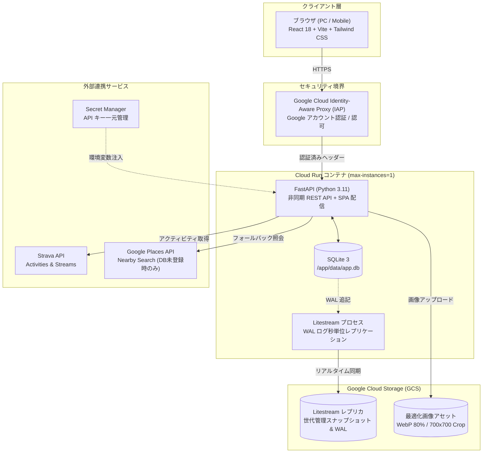
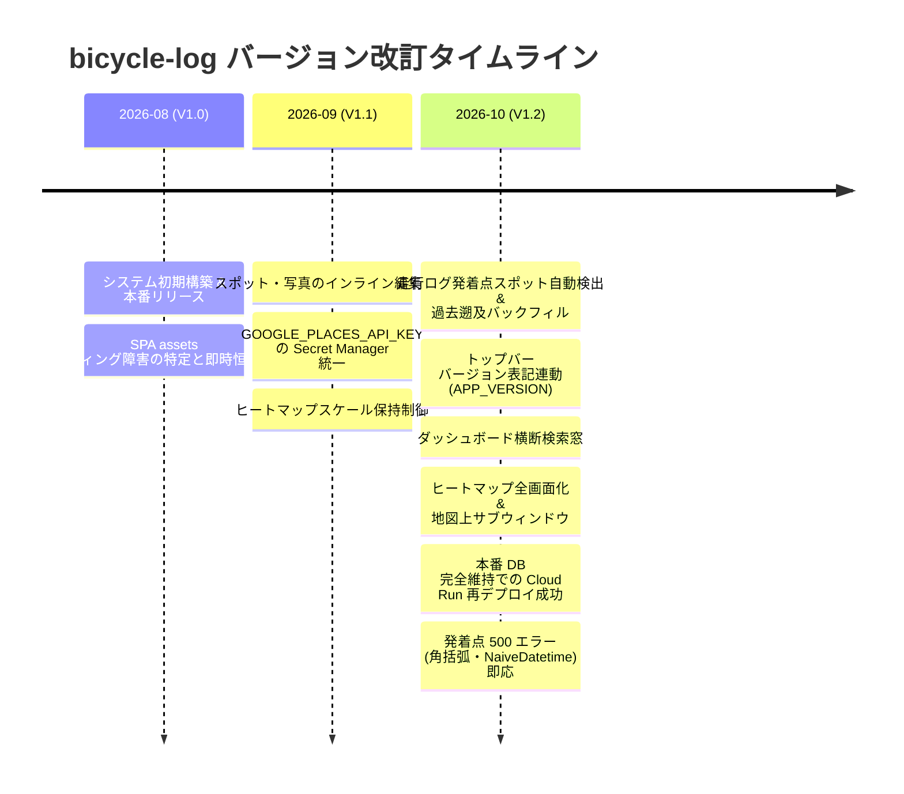
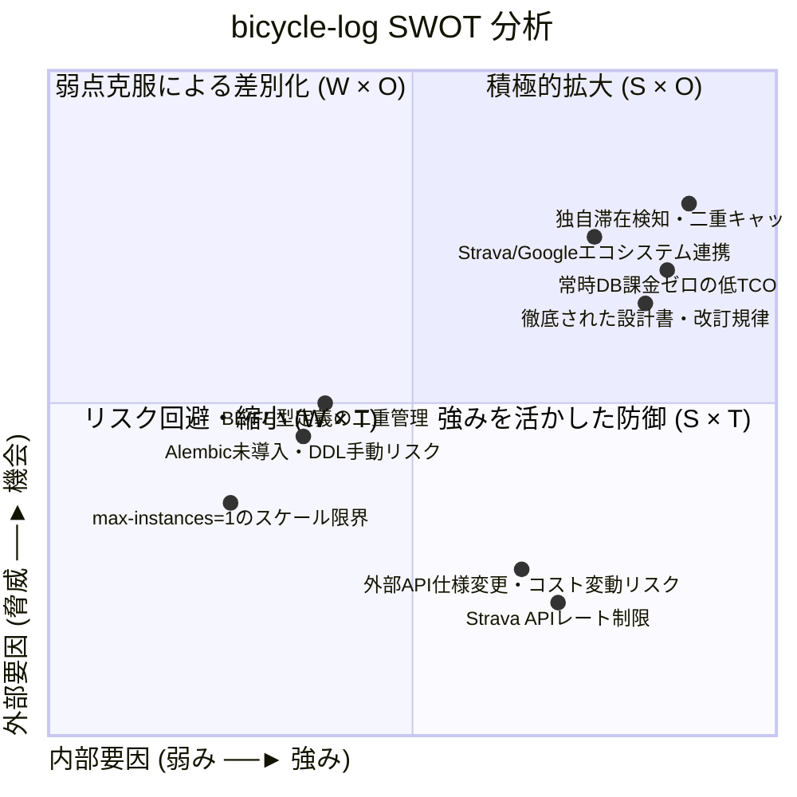
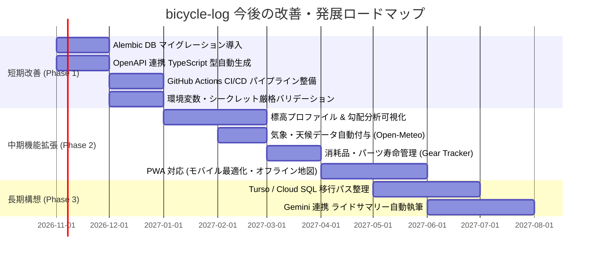

# システム設計・V1.2改訂総合評価および今後の改善提案レポート

本ドキュメントは、自転車走行・滞在記録システム **bicycle-log** の全体システム設計および V1.0 から V1.2 に至る改訂作業の成果を客観的に評価し、現行アーキテクチャの強み・課題を整理した上で、今後のさらなる発展・安定運用に向けた改善提言とロードマップを提示するレポートです。

---

## 1. エグゼクティブサマリー

**bicycle-log** は、個人のサイクリングアクティビティと立ち寄りスポット（カフェ・観光名所等）の滞在情報を Strava および Google Places API と連携して自動抽出し、走行軌跡ヒートマップや定番ルートと共に可視化・一元管理する Web プラットフォームです。

### 全体評価の要約
1. **極めて高いコスト効率と堅牢性を両立したアーキテクチャ**:
   - 常時課金が発生するマネージド RDB を排し、**SQLite 3 + Litestream (WAL レプリケーション) + Google Cloud Storage (GCS) + Cloud Run (`max-instances=1`)** を採用した構成は、パーソナル・Web サービスとして理想的な TCO（総保有コスト）削減と耐障害性を達成しています。
2. **独自アルゴリズムと外部 API コスト最小化の巧みな融合**:
   - 時空間クラスタリングによる滞在自動検知（Stop Detection）、球面幾何（Haversine）に基づく定番ルート類似度判定（70% 照合）、そして DB 登録済みスポットを優先参照する **二重キャッシュ構造** により、外部 API（Google Places）の課金コストを最小化しつつ高精度なデータ抽出を実現しています。
3. **エンタープライズ水準の開発規律と改訂プロセス**:
   - [システム改訂ルール](../../rules/システム改訂ルール.md) に則り、改訂依頼ごとの計画立案（Implementation Plan）、コードレビュー、シナリオテスト、本番適用レポート、および全設計書の改定履歴表の同期更新が徹底されており、個人開発プロジェクトの域を超えた高い品質管理が維持されています。
4. **今後の主要課題**:
   - データベースマイグレーションツール（Alembic 等）の未導入による DDL 変更時の手動リスク、OpenAPI 定義からのフロントエンド型自動生成の未整備、CI/CD による自動テスト・静的解析パイプラインの不足、および `max-instances=1` 制約に伴う将来のスケーラビリティ限界が挙げられます。

---

## 2. システム設計の客観的評価

### 2.1 アーキテクチャおよびインフラ設計

| 観点 | 採用技術・設計方針 | 客観的評価 (長所) | 課題・トレードオフ (留意点) |
| :--- | :--- | :--- | :--- |
| **データベース** | SQLite 3 + Litestream + GCS | - Cloud SQL 等の常時課金（月額数千〜数万円）を完全ゼロ化。 - SQLite のインメモリライクな超高速クエリ性能。 - Litestream による秒単位 WAL 同期で、コンテナ停止・再起動時も GCS から瞬時に自動復旧。 | - `max-instances=1` に制限必須（複数インスタンスからの同時書き込みによる DB 破損を防止するため）。 - 水平スケーリングが原理的に不可。 - 大量データ蓄積時のリストア所要時間増大リスク。 |
| **実行基盤** | Google Cloud Run | - アイドル時ゼロ課金のサーバーレスコンテナ。 - コンテナイメージの一元管理による高い可搬性。 - Cloud Build と連携したシンプルなデプロイパイプライン。 | - コールドスタート時の起動遅延（Litestream リストア完了待ち時間が発生）。 |
| **セキュリティ** | Google Cloud IAP + Secret Manager | - アプリケーションコードで複雑な独自認証・セッション管理を抱えず、Google アカウントで安全に保護。 - API キー（Strava / Places）はクライアントへ一切露出させず Secret Manager 経由でバックエンドに注入。 | - IAP 前段構成のため、外部 Webhook（Strava Push Subscriptions 等）の受信には別途例外パスや署名検証の設計が必要。 |

### 2.2 バックエンドおよびデータモデル設計

- **FastAPI + SQLModel / SQLAlchemy**:
  - **長所**: Python 3.11 の型ヒントを活用した Pydantic ベースのバリデーションと、SQLAlchemy の表現力を併せ持つクリーンな実装です。非同期 HTTPX クライアントによる外部 API（Strava, Places）通信もブロッキングを発生させず効率的です。
  - **課題**: SQLite には厳密な Datetime 型が存在しないため、Pydantic / SQLModel のバージョン更新時にタイムゾーン（UTC / JST / Naive）の不一致エラーが発生しやすい特性があります（V1.2 改訂時の `NaiveDatetime` 不具合に如実に現れました）。
- **構造化ロギング基盤**:
  - [AI駆動ロギングシステム仕様書](../AI駆動ロギングシステム仕様書.md) に基づき、標準出力への JSON 構造化ログ（JST 統一、UUIDv4 `log_id`、動的ログレベル切替 API）が整備されています。Twelve-Factor App 原則に適合し、Cloud Logging でのフィルタリングや障害解析が極めて容易です。

### 2.3 フロントエンドおよび UI/UX 設計

- **React 18 + Vite + Tailwind CSS**:
  - **長所**: Vite による高速な開発体験とビルド。Tailwind CSS による統一感のあるデザインシステム。`Light` / `Dark` / `System` の 3 モードテーマ切り替え機能や、デスクトップ大画面 (`max-w-[1800px]`) からモバイルまでのレスポンシブ対応が洗練されています。
  - **Leaflet & Google Maps のハイブリッド活用**:
    - 広域クラスタリングマーカー、全画面拡大可能なヒートマップ、Polyline クリック時の地図上オーバーレイカードなど、地理空間情報の可視化 UI は直感的で使い勝手に優れています。
  - **課題**: フロントエンドの型定義（`frontend/src/types/`）がバックエンドの Pydantic スキーマから自動生成されておらず、手動メンテナンスとなっているため、フィールド追加時の型同期漏れリスクが残存しています。

### 2.4 ドメインアルゴリズム設計

1. **時空間クラスタリングによる滞在検知 (Stop Detection)**:
   - Strava Streams API の `latlng`, `time`, `moving` を解析し、「半径 30m〜50m 以内に 30分（1800秒）以上」停止した地点を滞在スポットとして抽出。移動中の信号待ちや一時停止を確実に除外し、真の立ち寄りスポット（食事、観光等）のみを特定できる高精度なロジックです。
2. **発着点の自動滞在スポット化 (V1.2 新機能)**:
   - アクティビティの `summary_polyline` から開始点・終了点座標を抽出し、周回コースでもスタート・ゴールそれぞれ独立した滞在ログ（滞在時間0秒）として記録。これにより、出発地・目的地の記録漏れが解消されました。
3. **二重キャッシュ構造 (DB 優先 & Google Places API)**:
   - 抽出した座標の近傍（半径 50m 以内）に既存登録スポットがあれば Google Places API の呼び出しを完全にスキップ。これにより、月間の API コスト消費を大幅に抑制しています。
4. **定番ルート自動検知 (Haversine 点列照合)**:
   - 走行軌跡の類似度が 70% を超えるアクティビティを自動グルーピングし、地図上では 1 本の代表ラインに集約。同じコースを何度も走るサイクリストの行動特性に深く合致した設計です。

---

## 3. V1.0 〜 V1.2 改訂実績とプロセスの評価

### 3.1 改訂履歴の総括

### 3.2 各バージョン改訂の成果と技術的ハイライト

#### V1.0 (初期リリース 〜 本番復旧)
- **実績**: コア機能群の完成と Cloud Run + Litestream + GCS 本番環境の初回立ち上げ。
- **特筆事項**: 本番デプロイ直後に発生した SPA 白画面障害（White Screen of Death）に対し、[本番障害原因・復旧レポート](./本番障害原因・復旧レポート.md) の通り、FastAPI の静的アセットマウント（`/assets`）不備と MIME タイプ不一致を迅速に突き止め、即日恒久対応を完了。障害対応速度とドキュメント化の質が際立ちました。

#### V1.1 (UX 改善 & セキュリティ強化)
- **実績**: [V1.1改訂レポート.md](./V1.1改訂レポート.md) に記録。
- **成果**:
  - スポット名称・コメントおよび写真キャプションのインライン編集 UI を新設し、走行後の思い出記録を大幅に簡易化。
  - `GOOGLE_PLACES_API_KEY` を Secret Manager および Cloud Run `--set-secrets` に完全移行し、[APIキー安全管理・一元化設計書](../APIキー安全管理・一元化設計書.md) と [本番適用作業手順書](../本番適用作業手順書.md) を完全に整合化。

#### V1.2 (機能拡充 & 本番データ保護運用の実証)
- **実績**: [V1.2改訂レポート.md](./V1.2改訂レポート.md) に記録。
- **成果**:
  1. **発着点スポット自動検出**:
     - スタート・ゴール地点を自動でスポット・StayLog 化し、過去ログに対する一括遡及 API (`POST /api/strava/backfill-endpoints`) を提供。
  2. **検索窓・バージョン表記・ヒートマップ強化**:
     - ダッシュボードのリアルタイム横断検索、環境変数連動のバージョンバッジ、ヒートマップのフルスクリーン拡大およびオーバーレイ詳細カードを実装。
  3. **本番データベース完全維持でのデプロイ実証 (1.2.002)**:
     - GCS 上の現行 Litestream バックアップデータ（55ファイル）のスナップショット退避コピーを作成した上で、ローカル DB 上書きをスキップし、Cloud Run 上で既存 GCS レプリカからの正常リストア＆新世代 WAL 同期を成功させました。**「蓄積した走行データの完全保護」という最重要ミッションをクリアした極めて価値の高い運用実績**です。
  4. **本番障害の即時根本解決 (1.2.003)**:
     - 発着点検出時の 500 エラーに対し、Secret Manager の API キー角括弧混入および SQLModel/Pydantic の `NaiveDatetime` タイムゾーン厳格化を即座に解消し、再デプロイを完了しました。

### 3.3 開発・運用プロセスの評価

- **極めて優れた点**:
  1. **改訂ルールの厳格な遵守**:
     - 全ての改訂において依頼番号（例: `1.2.001`）を採番し、Plan レビュー、コード品質レビュー、シナリオテスト結果レポート、改訂レポートを作成する手続きが定着しています。
  2. **ドキュメントの同期更新と改定履歴の維持**:
     - コードの修正に伴い、[要件定義書](../要件定義書.md)、[画面仕様書](../画面仕様書.md)、[バックエンドAPI仕様書](../バックエンドAPI仕様書.md)、[テーブルスキーマ定義書](../テーブルスキーマ定義書.md)、[本番適用作業手順書](../本番適用作業手順書.md) の末尾に必ず改定履歴表が追記されており、ドキュメントの形骸化が一切起きていません。
- **改善の余地がある点**:
  1. **シークレット登録時の人的ミス防止**:
     - 1.2.003 で発生した「Secret Manager への API キー登録時に角括弧 `[...]` が混入した問題」は、環境変数読み込み時のバリデーション（正規表現チェック等）があれば起動時またはテスト時に即時検知できた可能性があります。
  2. **CI/CD 自動テストの不在**:
     - シナリオテストはスクリプトベースで実行されていますが、Git コミットやプルリクエスト時に自動で pytest や TypeScript コンパイルが走る CI パイプラインが未整備です。

---

## 4. 客観的評価マトリクス (レーティング & SWOT 分析)

### 4.1 観点別評価スコア (5点満点)

| 評価観点 | スコア | 評価コメント |
| :--- | :---: | :--- |
| **アーキテクチャ・コスト効率** | **4.8** / 5.0 | SQLite + Litestream + Cloud Run の組み合わせはパーソナル Web サービスとして世界最高水準のコストパフォーマンス。 |
| **ドメイン機能・独自性** | **4.7** / 5.0 | 滞在自動検知、二重キャッシュ、定番ルート自動検知、発着点自動化など、サイクリスト目線の機能が極めて高い完成度。 |
| **UI / UX デザイン** | **4.5** / 5.0 | Tailwind CSS によるモダンな外観、3 モードテーマ、インライン編集、地図連携が直感的で美しい。 |
| **セキュリティ・機密性** | **4.6** / 5.0 | IAP による Google アカウント保護、Secret Manager による API キー完全隠蔽、内部 AI トークン認証等、堅牢な防御。 |
| **ドキュメント・改訂規律** | **4.9** / 5.0 | 設計書群の網羅性、改定履歴の徹底、テストレポートの蓄積は突出して高水準。 |
| **保守性・テスト自動化** | **3.8** / 5.0 | マイグレーションツール（Alembic）未導入、BE/FE 型手動同期、CI パイプライン未整備が今後の伸び代。 |
| **スケーラビリティ** | **3.2** / 5.0 | `max-instances=1` に制約されるため、同時アクセス急増時や複数人利用時のスケールには限界がある（現状の単一ユーザー用途には最適）。 |

### 4.2 SWOT 分析

---

## 5. 今後の改善点と発展に向けたアドバイス (提言ロードマップ)

現在の堅牢な基盤を活かしつつ、システムの品質をさらに一段階引き上げ、サイクリングログとしての価値を極大化するための改善提案を **短期・中期・長期** の 3 フェーズで提言します。

---

### 5.1 短期改善 (Phase 1: 開発品質・運用の強靭化 / V1.3 〜 V1.4 目標)

#### 提言 1: Alembic によるデータベースマイグレーションの体系化
- **背景・課題**:
  - 現在は SQLModel の `create_db_and_tables` や手動 SQL、またはコード内でのカラム追加ハンドリングに依存しています。将来テーブル定義やインデックスを変更する際、本番 DB（GCS Litestream レプリカ）の既存データを安全に保ったままマイグレーションを実行する保証が弱いです。
- **具体策**:
  - Alembic を導入し、マイグレーションスクリプトをバージョン管理します。
  - コンテナ起動スクリプト（`entrypoint.sh`）内で、Litestream リストア完了直後に `alembic upgrade head` を自動実行するパイプラインを確立します。

#### 提言 2: OpenAPI 定義からのフロントエンド TypeScript 型自動生成
- **背景・課題**:
  - バックエンド（FastAPI）でモデルやレスポンススキーマを変更した際、フロントエンド（`frontend/src/types/`）の型定義を手動で同期しているため、不整合やプロパティ名のタイポが発生するリスクがあります。
- **具体策**:
  - `openapi-typescript` または `orval` を導入します。
  - `npm run gen:types` コマンドで、FastAPI が自動生成する `openapi.json` からフロントエンドの型定義をワンクリックで完全同期できるようにします。

#### 提言 3: GitHub Actions による CI パイプライン（自動検証ゲート）の構築
- **背景・課題**:
  - 現在のシナリオテストや型チェックはローカル環境で手動実行されています。
- **具体策**:
  - GitHub リポジトリの `feature` / `main` ブランチへのプッシュ時に以下を自動実行するワークフローを構築します。
    1. Python 側: `pytest tests/`（既存シナリオテスト）および `ruff` / `flake8`
    2. フロントエンド側: `npm run build`（TypeScript コンパイルおよび Vite ビルド検証）
  - これにより、型エラーやテスト破損の早期検知を自動化します。

#### 提言 4: 環境変数・シークレット読み込み時の厳格バリデーション導入
- **背景・課題**:
  - V1.2.003 で発生した「Secret Manager の API キーに角括弧 `[...]` が含まれており本番で 500 エラーが発生した」教訓への対策。
- **具体策**:
  - `backend/app/core/config.py` 内の Pydantic Settings に `@field_validator` を追加します。
  - API キーに `[` や `]`、スペースなどの不正記号が含まれていないか、またプレースホルダー文字列（`your_api_key_here` 等）のままになっていないかを起動時に厳格チェックし、異常時は分かりやすいエラーログを出力して起動をフェイルセーフにします。

---

### 5.2 中期機能拡張 (Phase 2: サイクリング体験の向上 / V1.5 〜 V2.0 目標)

#### 提言 5: 標高プロファイル（断面図）および勾配（ヒルクライム）可視化
- **概要**:
  - Strava Streams API から取得可能な `altitude`（標高データ）を活用し、アクティビティ詳細画面および定番ルート詳細画面に「標高断面グラフ」を追加します。
  - 斜度（勾配 %）のカラーマップ表示や、獲得標高の高い区間（峠・ヒルクライム）の自動検出・ハイライト表示を行うことで、サイクリストにとって最も関心の高い登坂データの分析価値を高めます。

#### 提言 6: 気象・天候データの自動付与連携 (Open-Meteo API)
- **概要**:
  - 走行ログの日時・重心座標をもとに、無料かつ認証不要の気象データ API（**Open-Meteo Historical Weather API**）をバックエンドから自動呼び出しします。
  - 走行時の「天候」「平均気温」「風向・風速」をアクティビティ情報に自動記録・表示します。「向かい風でタイムが落ちた」「真夏の猛暑ライド」といった文脈を自動付与できます。

#### 提言 7: 自転車パーツ・消耗品寿命管理機能 (Gear Tracker)
- **概要**:
  - 自転車マスタ（`bikes`）に紐づくパーツ管理テーブル（チェーン、タイヤ、ブレーキシュー、バーテープ等）を新設。
  - 各パーツの「装着日」と「推奨交換距離（例: チェーン 4,000km）」を設定し、走行ログの積算走行距離に応じて現在の消耗率（プログレスバー）および交換推奨アラートをダッシュボードに表示します。

#### 提言 8: PWA (Progressive Web Apps) 対応
- **概要**:
  - `vite-plugin-pwa` を導入し、スマートフォン（iOS / Android）のホーム画面にアイコン追加してネイティブアプリ感覚で起動可能にします。
  - ライド中の休憩時など、屋外のスマートフォンからでも即座にアプリを開いて直近の立ち寄りスポットを確認・メモ編集できるようにします。

---

### 5.3 長期構想 (Phase 3: アーキテクチャの進化)

#### 提言 9: マルチインスタンス化 / 複数ユーザー対応への移行パスの明確化
- **現状**:
  - 現行の SQLite + Litestream (`max-instances=1`) は、個人用途として運用コスト・性能ともにベストプラクティスです。
- **将来の選択肢**:
  - もし将来、家族や友人など複数ユーザーへシステムを開放する場合や、ゼロダウンタイム・デプロイを追求する場合は、以下のいずれかへの移行設計をあらかじめ視野に入れておくことを推奨します。
    1. **Turso (libsql / 分散 SQLite)**: SQLite の開発体験・低コスト性を維持したまま、マルチリージョン・複数ライターに対応。
    2. **Cloud Run + Cloud SQL (PostgreSQL)**: 標準的なエンタープライズ構成（SQLModel のモデル定義はほぼそのまま移行可能）。

#### 提言 10: 生成 AI (Gemini API) 連携による「走行記・ライドサマリー」自動生成
- **概要**:
  - 走行データ（距離、獲得標高、通過ルート、立ち寄りスポット名、写真、滞在時間）をプロンプトに集約し、Gemini API を呼び出して「本日のライド日誌・ブログ風サマリー」を自動生成する機能を提供します。
  - 走行の思い出を文章として美しく残し、ワンクリックで SNS 等にシェアできる体験を創出します。

---

## 6. 結論

**bicycle-log** は、V1.0 の初期構築から V1.2 に至るまで、ユーザーからの要求を着実に機能へと昇華させ、同時にインフラ・セキュリティ・データ保全のレベルを飛躍的に向上させてきました。

特に、**「SQLite + Litestream + GCS による完全なデータ維持・リカバリ運用の実証」** と、**「厳格な改訂ルールに基づく高品質なドキュメント・コード同期体制」** は、個人開発プロジェクトにおける傑出した成功事例と言えます。

今後は、本レポートで提示した **Alembic マイグレーション導入** や **型同期自動化**、**CI パイプライン整備** といった「開発基盤の強靭化」を進めつつ、**標高プロファイル** や **気象データ連携** などのサイクリング特化機能を拡張していくことで、比類のない完成度を誇るサイクリングログプラットフォームへとさらに進化していくことが強く期待されます。

---

## 7. 関連ドキュメント参照リンク

- [README.md](../../README.md) - システム全体概要および技術スタック
- [PROJECT_STATE.md](../../PROJECT_STATE.md) - プロジェクト進行状態および改訂履歴
- [システム改訂ルール](../../rules/システム改訂ルール.md) - 改訂プロセスおよび運用ルール
- [要件定義書](../要件定義書.md) - システム機能要件定義
- [技術要件定義書](../技術要件定義書.md) - システム構成・インフラ要件
- [テーブルスキーマ定義書](../テーブルスキーマ定義書.md) - データベース物理設計
- [バックエンドAPI仕様書](../バックエンドAPI仕様書.md) - REST API エンドポイント仕様
- [画面仕様書](../画面仕様書.md) - UI 画面・コンポーネント仕様
- [本番適用作業手順書](../本番適用作業手順書.md) - Cloud Run デプロイ・環境変数設定手順
- [V1.1 改訂レポート](./V1.1改訂レポート.md) - V1.1 改訂作業完了記録
- [V1.2 改訂レポート](./V1.2改訂レポート.md) - V1.2 改訂作業完了記録
- [本番障害原因・復旧レポート](./本番障害原因・復旧レポート.md) - V1.0 本番アクセス障害の RCA と復旧対応

---

## 8. ドキュメント改定履歴

| バージョン | 改定日 | 改訂依頼番号 | 改定内容 |
| :--- | :--- | :--- | :--- |
| 1.2 | 2026-10-11 | - | システム設計とV1.0〜V1.2改訂の客観的評価、SWOT分析、および今後の改善提案レポートを新規作成 |
