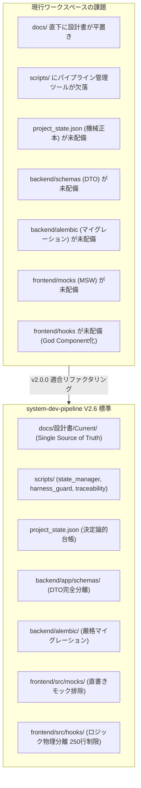

# system-dev-pipeline V2.6 適合性・乖離分析レポート (v2.0.0 全面改訂)

- **プロジェクト名**: bicycle-log
- **対象バージョン**: v1.2 ➔ v2.0.0
- **作成日**: 2026-10-28
- **作成者**: 👑 プロジェクトコンダクター
- **監査ツール**: `harness_guard.py`, `traceability_checker.py`, `state_manager.py` (V2.6)

---

## 1. エグゼクティブサマリ

開発支援パイプライン `system-dev-pipeline` が V2.6 へアップグレードされたことに伴い、現行 `bicycle-log` システムの適合状況を多角的に監査した。
監査の結果、**ディレクトリ構造、アーキテクチャ規約、ドキュメント管理、コード品質（特に Anti-God Component 250行制限とレイヤーバイパス）において合計 55 件の機械的規約違反**が検出された。
また、プロジェクトルートおよび `rules/` 配下に残留する旧バージョン（V2.1）のローカルルール文書が、V2.6 のグローバル規約と直接衝突し、開発プロセスの重大なノイズとなっていることが判明した。

本レポートでは、検出されたすべての乖離点を体系的に整理し、v2.0.0 全面改訂におけるリファクタリング方針および移行戦略を定義する。

---

## 2. 旧バージョンルール・規約のバッティング調査

現行ワークスペースには、過去の改訂サイクルで配置されたルール文書が残留しており、V2.6 のグローバル規約と以下のようにバッティングしている。

| 対象ファイル | 現行の内容・バージョン | V2.6 グローバル規約とのバッティング・問題点 | 是正方針 (ユーザー方針準拠) |
| :--- | :--- | :--- | :--- |
| `rules/dev-process-standards.md` | V2.1 基準のプロセス標準規約 | ・コンポーネント行数制限が「300行以下」と記載（V2.6は「250行/400行制限」）。<br>・`state_manager.py` による `project_state.json` 機械正本管理・SHA256ハッシュ検証が未反映。<br>・Central Knowledge Hub 3段階意味的監査（Soft Engine）の規定が欠落。 | **全廃・削除**<br>（プラグイン側 `rules/AGENTS.md` および `CORE_INVARIANTS.md` に一本化） |
| `rules/システム改訂ルール.md` | V2.1 基準の改訂運用ルール | ・手動での `PROJECT_STATE.md` 更新を前提としており、`state_manager.py start-revision / complete-revision` コマンド体系と不整合。<br>・Single Source of Truth（`docs/設計書/Current/`）の物理構造規定と不一致。 | **全廃・削除**<br>（パイプライン標準ライフサイクルに統合） |
| `AGENTS.md` (ルート直下) | Docker コンテナ再構成指示、旧改訂ルール参照 | ・Docker操作の独自ルールやローカル改訂ルールの参照が直書きされており、V2.6 のオーケストレーション体制・コマンド体系と重複・ノイズ化。 | **全廃・削除** |
| `GEMINI.md` (ルート直下) | Docker コンテナ再構成ルール、開発原則 | ・上記 `AGENTS.md` と同一内容の重複であり、AIエージェントのプロンプトコンテキストを無用に肥大化。 | **全廃・削除** |

> [!IMPORTANT]
> **結論**: ローカルのルール文書（`AGENTS.md`, `GEMINI.md`, `rules/` 配下の規約文書）はすべて撤廃し、AI Harness のグローバル設定（`~/.gemini/config/plugins/system-dev-pipeline/rules/`）を唯一の規範とすることで、ルールの二重管理とプロンプトノイズを完全に解消する。

---

## 3. ディレクトリ構造およびファイルの乖離分析

### 3.1 ディレクトリ構造の比較



### 3.2 必要・不要ファイルの洗い出し

#### A. 新規作成・配備が必要なファイル・ディレクトリ
1. **パイプライン管理スクリプト群**:
   - `scripts/state_manager.py`（状態台帳管理・ハッシュ検証）
   - `scripts/harness_guard.py`（Shift-Left Hard Gate 検査）
   - `scripts/traceability_checker.py`（要件-設計-テスト トレーサビリティ検証）
   - `.githooks/pre-commit`（コミット前 Hard Gate 物理遮断フック）
   - `.editorconfig`, `.github/workflows/ci.yml`（スケルトン共通設定）
2. **状態台帳機械正本**:
   - `project_state.json`（現行 `PROJECT_STATE.md` の全履歴・メトリクスを継承して初期化）
3. **ドキュメント構造化**:
   - `docs/設計書/Current/`（`要件定義書.md`, `技術要件定義書.md`, `テーブルスキーマ定義書.md`, `ビジネスロジック仕様書.md`, `画面仕様書.md`, `バックエンドAPI仕様書.md` を集約・最新化）
   - `docs/検討課題/`（過渡期ディスカッションの隔離）
   - `docs/plans/scenario-test/`, `docs/plans/metrics/`
4. **バックエンド新設レイヤー**:
   - `backend/app/schemas/`（リクエスト/レスポンス DTO 定義）
   - `backend/app/core/auth.py`（IAP JWT 署名二重検証ミドルウェア）
   - `backend/app/core/cache.py`（外部API二重キャッシュ機構）
   - `backend/alembic/`, `backend/alembic.ini`（Alembic マイグレーション基盤）
5. **フロントエンド新設レイヤー**:
   - `frontend/src/mocks/`（MSW ブラウザワーカー・ハンドラー）
   - `frontend/src/hooks/`（各画面のステート・ロジック分離）
   - `frontend/src/components/`（250行以下のサブコンポーネント群）

#### B. 整理・削除・アーカイブ対象ファイル
1. **不要ルール文書**: `AGENTS.md`, `GEMINI.md`, `rules/dev-process-standards.md`, `rules/システム改訂ルール.md`（削除）
2. **過渡期・旧世代ドキュメント**:
   - `docs/implementation_plan.md`, `docs/定番ルート機能実装計画.md`, `docs/データベースの再アップロード手順.md`, `docs/AI駆動システム開発フェーズ定義書.md`（`docs/検討課題/archive/` へ退避または削除）
3. **作業残骸・一時ファイル**:
   - `restore_tmp/`（空ディレクトリ削除）
   - `data/app.db.before_*`, `data/app.db.old`（バックアップアーカイブ `backup/archive/` へ集約）
   - `docs/plans/v1_legacy/`, `docs/reports/v1_legacy/`（構造正規化）

---

## 4. ソースコードレビューおよびリファクタリングレポート

`harness_guard.py --all` による機械検査で検出された 55 件の違反を分類・分析した。

### 4.1 フロントエンド違反分析（Anti-God Component / 行数制限違反）

| ファイル名 | 行数 | 制限 | 超過比率 | 主な原因とリファクタリング方針 |
| :--- | :--- | :--- | :--- | :--- |
| `frontend/src/pages/ItemDetailPage.tsx` | **1,443行** | 250行 | **577%** | 地図描画、走行ログ一覧、スポット編集、写真アップロード、タグ管理が単一ファイルに混在。<br>➔ `useItemDetailMap`, `useSpotManager` などのカスタムフックと、`SpotListSection`, `PhotoUploadModal` 等のサブコンポーネントへ 7 分割。 |
| `frontend/src/pages/AnalyticsPage.tsx` | **1,127行** | 250行 | **451%** | グラフ描画（Chart.js）、期間集計、カテゴリ分析、ヒートマップロジックが同居。<br>➔ `useAnalyticsData` フックと、`MonthlyDistanceChart`, `CategoryRatioCard`, `HeatmapView` 等のサブコンポーネントへ 5 分割。 |
| `frontend/src/pages/MasterPage.tsx` | **870行** | 250行 | **348%** | 自転車設定、スポットカテゴリ、タグ、Strava連携設定の管理画面が一体化。<br>➔ タブごとに `BikeSettingsTab`, `CategorySettingsTab`, `TagSettingsTab`, `StravaSettingsTab` に物理分離。 |
| `frontend/src/pages/DashboardPage.tsx` | **635行** | 250行 | **254%** | サマリカード、最近のライド一覧、マッププレビュー、クイックアクションが同居。<br>➔ `useDashboard` フック、`RecentRidesCard`, `SummaryStatsCard` 等へ 3 分割。 |
| `frontend/src/pages/ItemsPage.tsx` | **370行** | 250行 | **148%** | 検索・フィルタリングUIとリスト描画が同居。<br>➔ `SearchBar`, `FilterDrawer`, `ItemListCard` へ分離。 |
| `frontend/src/components/RouteDetailModal.tsx` | **260行** | 250行 | **104%** | モーダル内のポリライン解析ロジックとUIが同居。<br>➔ `useRoutePolyline` フック抽出により 180 行へスリム化。 |

### 4.2 フロントエンド直書きモック・画面グランドデザイン適合

- **直書きモック排除**: コンポーネント内のインラインダミーデータを撤廃し、MSW (`src/mocks/handlers.ts`) に完全集約。環境変数 `VITE_ENABLE_MOCK=false` 時は実バックエンドと透過通信する構成へ改訂。
- **画面グランドデザイン準拠**:
  - 4px/8px グリッドの厳格適用（Tailwind クラス `p-4`, `gap-2`, `h-8` 等の体系化）。
  - デイライト視認性（明暗ペア指定 `bg-white dark:bg-slate-900 text-slate-800 dark:text-slate-100`）。
  - HEX / px 絶対値の CSS 変数定義およびデザイントークン化。

### 4.3 バックエンド違反分析（AST アーキテクチャ適応度違反）

| 違反種別 (ID) | 検出箇所 | 問題内容 | 是正方針 |
| :--- | :--- | :--- | :--- |
| **バックエンド行数超過 [HG-001]** | `backend/app/services/strava_service.py` (417行 > 400行) | OAuth認証、アクティビティ取得、ストリームデータ解析が単一モジュールに混在。 | `strava_client.py` (API通信) と `strava_parser.py` (ストリーム解析) に分割。 |
| **レイヤーバイパス [HG-005]** | `routers/analytics.py` (5件)<br>`routers/stay_logs.py` (4件)<br>`routers/routes.py` (2件) | API ルーターが SQLAlchemy モデル（`models.*`）を直接インポートして直接 DB 操作を実施。 | `schemas/` (Pydantic DTO) を新設し、ルーターは DTO と `services/` のみを呼び出す構造へ全面改訂。 |
| **生SQL DDL 検出 [HG-004]** | `backend/app/core/database.py:59` | `engine.execute("CREATE TABLE ...")` 形式の生SQL手動DDLが存在。 | 生SQL DDLを完全撤廃し、Alembic マイグレーションによるスキーマ管理へ移行。 |
| **例外握りつぶし [HG-005]** | `core/database.py:61`<br>`services/image_service.py:14, 36, 50` | `except Exception: pass` によるエラーのサイレント無視。 | 例外型を特定し、`logger.error()` による構造化ログ記録および適切な HTTPException 送出へ改修。 |
| **平文シークレット [HG-007]** | `.env:12-13` (Google Places API Key) | 開発用 API キーが生値でコミット・配置されている。 | Pydantic Settings による厳格検証を導入し、`.env.example` のプレースホルダー運用へ改訂。 |

---

## 5. 要件トレーサビリティおよびドキュメント整合性の乖離

`traceability_checker.py --mode design` の実行結果:
```
⚠️ 要件定義書から [REQ-*] ID が抽出されませんでした。
```

- **現状**: 現行の `docs/要件定義書.md` には V2.6 必須の要件採番 `[REQ-F01]`, `[REQ-NF01]` 等が存在せず、自由形式の箇条書きとなっている。
- **影響**: 各設計書（技術・スキーマ・ロジック・画面）およびテストコードとのトレーサビリティ機械検証が遮断されている。
- **是正方針**:
  - 現行システムの全機能（自転車管理、Strava同期、滞在スポット記録、ルート解析、統計分析）を `[REQ-F01]` 〜 `[REQ-Fxx]` として体系的に再採番。
  - 定常コア 8 項目を `[REQ-NF01]` 〜 `[REQ-NF08]` として完全バインド。
  - 4大基本設計書およびバックエンドAPI仕様書に対応要件IDを明記し、`traceability_checker.py` の 100% カバレッジを達成する。

---

## 6. バージョニングの乖離状況

| 対象コンポーネント | 現行バージョン表記 | 目標バージョン (本改訂) | 整合方針 |
| :--- | :--- | :--- | :--- |
| `.env` (`APP_VERSION`) | `2.0.0` | `2.0.0` | 正本値として維持 |
| `PROJECT_STATE.md` | `v1.2` | `v2.0.0` | `project_state.json` への移行時に更新 |
| `frontend/package.json` | `1.0.0` | `2.0.0` | `package.json` を 2.0.0 に更新 |
| `backend/app/main.py` | `settings.APP_VERSION` | `2.0.0` | `config.py` と同期 |
| Git タグ・ブランチ | タグ: `v1.2` / ブランチ: `feature` | タグ: `v2.0.0` / ブランチ: `feature/v2.0.0-upgrade` | 本番リリース時に `dev-git-release` でタグ付け |

---

## 7. 本番データ保全プロトコル（保全対象: `data/app.db`）

本システムのデータベース `data/app.db`（SQLite WAL）には実運用データが存在する。

```
- bikes: 3 レコード
- places: 2 レコード
- activities: 1 レコード
- stay_logs: 1 レコード
- その他関連レコード（activity_tags, place_tags, stay_log_images など）
```

### 保全のための必須手順
1. **事前コールドバックアップ**: 改訂着手前に `data/app.db` の完全スナップショットを `backup/v2.0.0_pre_upgrade_snapshot.db` として保存。
2. **Alembic ベースラインの確立**: 既存スキーマを Alembic の `0001_initial_baseline` としてリバースエンジニアリングし、実データを破壊せず `--sql` ドライランで安全性を確認した上で `alembic stamp` を実行。
3. **データ検証スクリプトの実行**: マイグレーション前後で全テーブルのレコード数・外部キー整合性・チェックサムを比較検証する自動検証スクリプトを作成・実行する。

---

## 8. 次のアクション

本レポートに基づき、以下の文書群を `docs/plans/v2.0.0改訂計画/` 配下に策定する。

1. **`v2.0.0全面改訂基本計画書.md`**: 全体工程、エージェント協調モデル、ステージ分割、承認ゲート、Git運用。
2. **ステージ別詳細作業手順書**:
   - `STAGE1_台帳移行と不要ルール撤廃.md`
   - `STAGE2_ディレクトリ構造化とスケルトン統合.md`
   - `STAGE3_要件定義と基本設計の再構築.md`
   - `STAGE4_バックエンドリファクタリングとAlembic統合.md`
   - `STAGE5_フロントエンド分割とグランドデザイン適合.md`
   - `STAGE6_スルーテストとトレーサビリティ検証.md`
   - `STAGE7_システム総合レビューとユーザー視認検証.md`
   - `STAGE8_本番データ保全デプロイとv2.0.0リリース.md`
