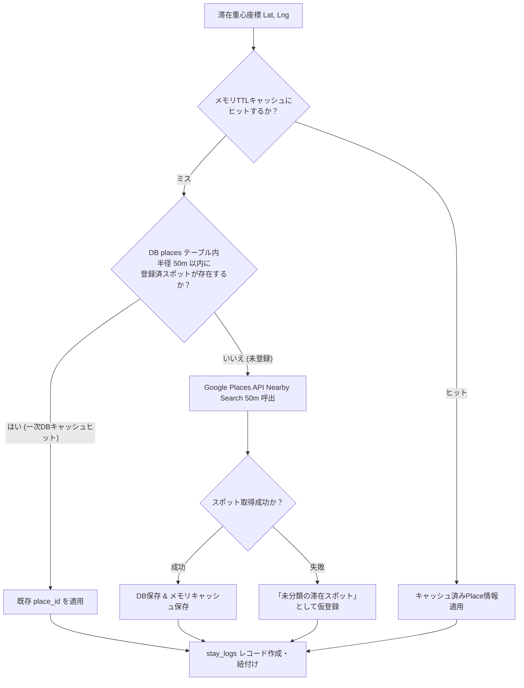

# ビジネスロジック仕様書 (BUSINESS_LOGIC_SPECIFICATION)

## 1. 概要

本ドキュメントは、「**bicycle-log**」における主要機能の判定基準、計算アルゴリズム、Strava API 同期、滞在自動検知（Stop Detection）、外部API二重キャッシュ、画像最適化、定番ルート検出、およびモック制御などのビジネスロジックを定義する。

- **対応要件**: `[REQ-F02]`, `[REQ-F03]`, `[REQ-F04]`, `[REQ-F05]`, `[REQ-F06]`, `[REQ-F07]`, `[REQ-NF06]`, `[REQ-NF07]`

---

## 2. Strava API 同期 & 滞在自動検知ロジック (`[REQ-F02]`, `[REQ-F03]`, `[REQ-NF06]`)

### 2.1 自動同期トリガー
- 同日初回ログイン時または手動同期ボタン押下時、`activities.start_date` の最新値以降のアクティビティを取得する。

### 2.2 滞在自動検知アルゴリズム (Stop Detection)
- **判定パラメータ**: 半径 $R = 30\text{m} \sim 50\text{m}$ 以内、経過時間 $\Delta t \ge 1800\text{秒}$ (30分) 以上停止。
- **重心座標算出**:
  $$\text{Lat}_{stop} = \frac{1}{N}\sum_{i=1}^{N}\text{Lat}_i, \quad \text{Lng}_{stop} = \frac{1}{N}\sum_{i=1}^{N}\text{Lng}_i$$
- **日時確定 (`[REQ-NF06]`)**: 到着日時 `arrived_at`、出発日時 `left_at` を Aware UTC で算出・保存。

---

## 3. 外部API二重キャッシュ制御ロジック (`[REQ-F03]`)

Google Places API の呼び出し回数・課金を抑制するため、二重キャッシュ戦略を適用する。

- **一次キャッシュ (DB `places`)**: 球面距離 (Haversine) で半径 50m 以内を検索。ヒット時は API 呼出をスキップ。
- **インメモリキャッシュ**: 直近参照スポットを TTL メモリキャッシュで保持し、DB 負荷も低減。

---

## 4. 走行ログ発着点検出ロジック (`[REQ-F03]`)

1. **Polyline 端点抽出**: `summary_polyline` をデコードし、最初の一点 $(Lat_{start}, Lng_{start})$ を開始点、最後の一点 $(Lat_{end}, Lng_{end})$ を終了点として抽出。
2. **二重キャッシュ照合**: 開始点・終了点を二重キャッシュと照合して Place を特定。
3. **StayLog 登録**:
   - スタート地点: `stay_duration_seconds = 0`, `notes = "{place.name} (スタート地点)"`
   - ゴール地点: `stay_duration_seconds = 0`, `notes = "{place.name} (ゴール地点)"`
   - 重複登録防止ロジックおよび一括遡及 API (`POST /api/strava/backfill-endpoints`) を提供。

---

## 5. 画像アップロード & 最適化ロジック (`[REQ-F04]`)

- **最適化処理**: アップロード画像を Pillow / WebP ライブラリで中央基準クロップ (Center Crop) により **700px × 700px 正方形** にリサイズし、**WebP 形式 (Quality: 80%)** に圧縮変換して GCS へ保存。
- **外部URL参照**: 外部 Web 上の画像 URL 指定時は GCS 送信を行わず参照 URL のみ保持。

---

## 6. 定番ルート自動検出アルゴリズム (`[REQ-F05]`)

1. **Polyline デコード & Haversine サンプリング照合**: 50m〜100m 間隔で点をサンプリングし、双方向の近接点割合 $R_{A \to B}, R_{B \to A}$ から総合類似度 $S(A, B) = \min(R_{A \to B}, R_{B \to A})$ を算出。
2. **70% 近似判定**: $S(A, B) \ge 0.70$ の場合、同一定番ルートと判定し、最長データ長を持つ Polyline を代表 Polyline として登録。
3. **Strava 同期時自動紐付け**: 新規アクティビティ取得時に既存定番ルートとの類似度を照合し、70% 以上で自動紐付け。

---

## 7. 統計集計 & 横断検索ロジック (`[REQ-F06]`)

- **ダッシュボード集計**: 自転車別の走行距離、上昇量、時間、回数、カロリーを年間/月間/週間単位で動的集計。
- **横断検索 (`GET /api/search?q={query}`)**: 滞在スポット（名称、住所、コメント、カテゴリ）および定番ルート（名称）を部分一致検索（最大各10件）。

---

## 8. マスタデータ保護制御ルール (`[REQ-F01]`, `[REQ-F07]`)

- 自転車マスタ (`bikes`) やカテゴリマスタ (`place_categories`) の削除時、子レコードが存在する場合は **物理削除を拒否し HTTP 409 Conflict** を返却。
- 定番ルート (`routes`) 削除時は、配下アクティビティの `activities.route_id` を NULL にリセット。

---

## 9. モック制御仕様 (`[REQ-NF07]`)

- **案C (環境変数切替) ＋ 案A (直書きモック排除)**:
  - フロントエンドモックは MSW (Mock Service Worker) に集約し、コンポーネント内のインラインモックを完全排除。
  - 環境変数 `VITE_ENABLE_MOCK=true` で MSW を起動。本番環境ビルド時はバンドルから除外し二重防御。
  - 実結合モードでのサイレントモックフォールバックは厳格禁止。

---

## 10. 改定履歴

| バージョン | 改定日 | 改訂依頼番号 | 改定内容 |
| :--- | :--- | :--- | :--- |
| 1.0.0 | 2026-08-21 | - | 初版作成 |
| 1.1 | 2026-09-02 | 1.1.001 | スポットコメント・写真コメント編集ロジック追加 |
| 1.2 | 2026-09-30 | 1.2.001 | 発着点検出、横断検索、バージョン管理ロジック追加 |
| 2.0.0 | 2026-10-28 | 2.0.001 | system-dev-pipeline V2.6 準拠: 二重キャッシュ戦略、モック制御仕様 (`[REQ-NF07]`)、Aware UTC (`[REQ-NF06]`)、全機能要件 (`[REQ-F02]`〜`[REQ-F07]`) バインド |
