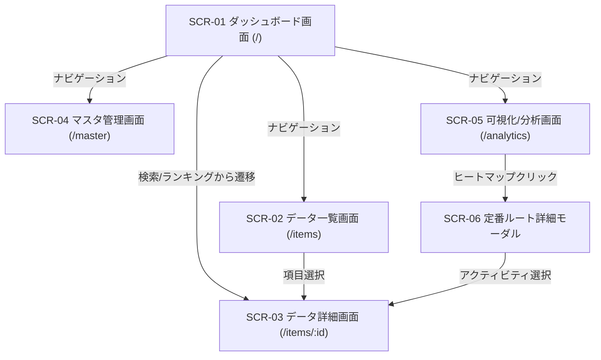

# 画面仕様書 (SCREEN_SPECIFICATIONS)

## 1. 概要

本ドキュメントは、「**bicycle-log**」における画面レイアウト、UI/UXデザイン仕様、インタラクション、画面遷移、および各種コンポーネント構成を定義する。

- **対応要件**: `[REQ-F01]`, `[REQ-F02]`, `[REQ-F03]`, `[REQ-F04]`, `[REQ-F05]`, `[REQ-F06]`, `[REQ-F07]`, `[REQ-NF01]`, `[REQ-NF03]`, `[REQ-NF07]`, `[REQ-NF08]`

---

## 2. 画面一覧および画面遷移図

### 2.1 画面一覧
| 画面ID | 画面名称 | ルーティング | 主な機能・対応要件 |
| :--- | :--- | :--- | :--- |
| `SCR-01` | ダッシュボード画面 | `/` | 主要サマリー表示、横断検索、直近アクティビティ、滞在ランキング (`[REQ-F03]`, `[REQ-F06]`) |
| `SCR-02` | データ一覧画面 | `/items` | アクティビティ/スポット一覧、リアルタイム検索、フィルター (`[REQ-F01]`, `[REQ-F02]`, `[REQ-F03]`) |
| `SCR-03` | データ詳細画面 | `/items/:id` | アクティビティ/スポット詳細、マップ表示、発着点バッジ、写真ギャラリー (`[REQ-F03]`, `[REQ-F04]`) |
| `SCR-04` | マスタ管理画面 | `/master` | 自転車、カテゴリ、定番ルート、タグのマスタメンテナンス (`[REQ-F01]`, `[REQ-F05]`, `[REQ-F07]`) |
| `SCR-05` | 可視化/分析画面 | `/analytics` | 期間別メトリクスグラフ、Polylineヒートマップ、全画面拡大、ルートカード (`[REQ-F05]`, `[REQ-F06]`) |
| `SCR-06` | 定番ルート詳細モーダル | - | 定番ルートの代表Polyline、配下アクティビティ一覧表示 (`[REQ-F05]`) |

### 2.2 画面遷移図

---

## 3. 画面グランドデザイン新規格 (`[REQ-NF08]`, `[REQ-NF01]`, `[REQ-NF03]`)

### 3.1 グリッドシステムとコンポーネント分離規約 (`[REQ-NF01]`, `[REQ-NF08]`)
- **8px / 4px グリッド**: 余白（Margin/Padding）、要素間隔（Gap）はすべて 4px / 8px の倍数（Tailwind: `p-2`, `p-4`, `p-6`, `gap-4` 等）を厳守する。
- **Anti-God Component 規約 (`[REQ-NF01]`)**: フロントエンドの各コンポーネントは **1ファイル最大250行** に制限する。Hooks、APIサービスクライアント、共通コンポーネントを厳格に物理分離する。
- **感覚センサー適合 (`[REQ-NF03]`)**: コンソールエラー 0件、WCAG AA 適合（コントラスト比 4.5:1 以上）、ボタン等のタップターゲット（最小 44px × 44px）を遵守する。

### 3.2 カラートークンと明暗ペア仕様 (`[REQ-NF08]`)
すべてのカラー指定は HEX/px 絶対値と Tailwind トークンを併記し、デイライト視認性を保証する。

| トークン名 | ライトモード (HEX) | ダークモード (HEX) | Tailwind クラス名 |
| :--- | :--- | :--- | :--- |
| `bg-primary` | `#FFFFFF` (255,255,255) | `#0F172A` (15,23,42) | `bg-white dark:bg-slate-900` |
| `bg-secondary`| `#F8FAFC` (248,250,252) | `#1E293B` (30,41,59) | `bg-slate-50 dark:bg-slate-800` |
| `text-primary`| `#0F172A` (15,23,42) | `#F8FAFC` (248,250,252) | `text-slate-900 dark:text-slate-50` |
| `text-muted`  | `#64748B` (100,116,139) | `#94A3B8` (148,163,184) | `text-slate-500 dark:text-slate-400` |
| `accent`      | `#0284C7` (2,132,199) | `#38BDF8` (56,189,248) | `text-sky-600 dark:text-sky-400` |
| `border`      | `#E2E8F0` (226,232,240) | `#334155` (51,65,85) | `border-slate-200 dark:border-slate-700` |

---

## 4. 画面別詳細仕様

### 4.1 ダッシュボード画面 (`SCR-01`) - `[REQ-F03]`, `[REQ-F06]`
- **トップバナー & リアルタイム横断検索窓**: 300ms デバウンスで `GET /api/search` を呼び出し、スポット・ルートを即座にサジェスト。
- **主要サマリーカード**: 総走行距離、総上昇量、総ライド回数、累積スポット数を表示。
- **直近アクティビティ & 滞在ランキング上位10件**: リスト表示および詳細遷移。

### 4.2 データ一覧画面 (`SCR-02`) - `[REQ-F01]`, `[REQ-F02]`, `[REQ-F03]`
- **タブ切替**: アクティビティ一覧／滞在スポット一覧。
- **検索・フィルター**: リアルタイムあいまい検索、カテゴリ/Bikeフィルター、Strava同期ボタン、定番ルート検出ボタン。
- **レスポンシブ**: デスクトップはテーブル表示、モバイルはカード型表示。

### 4.3 データ詳細画面 (`SCR-03`) - `[REQ-F03]`, `[REQ-F04]`
- **地図 & メタデータ**: Google Maps 上にスポットマーカーおよびアクティビティ Polyline を描画。名称・コメントのインライン編集。
- **発着点バッジ**: スタート地点・ゴール地点の滞在ログに専用バッジを表示。
- **写真ギャラリー**: WebP 正方形サムネイル表示、拡大モーダル、コメント編集。

### 4.4 可視化/分析画面 (`SCR-05`) - `[REQ-F05]`, `[REQ-F06]`
- **5大メトリクスカード**: 画面最上部に走行距離（青）、獲得標高（紫）、移動時間（橙）、ライド回数（緑）、消費カロリー（赤）の主要指標カードを常時表示。
- **期間別走行メトリクス可視化 (横棒プログレスバー)**:
  - タブピル切替: 「走行距離 (km)」「獲得標高 (m)」「移動時間 (h)」「回数 (回)」「カロリー (kcal)」。
  - 年別カプセル型横棒プログレスバーによる視認性の高い比較表示（バー内白文字数値＋行右端フォーマット数値）。
- **走行ヒートマップ & 定番ルート**:
  - 全画面拡大時の自動リサイズ追従（`invalidateSize()` 即時再計算による未描画防止）。
  - スポットマーカーのカテゴリ別アイコン表示（詳細画面と同等の `divIcon` 統一）。
  - 地図上ポップアップからのダイレクト詳細遷移ボタン（定番ルート詳細モーダル起動、および `/items/:id?type=activity` / `/items/:id?type=place` への SPA 高速遷移）。
  - グレースケール表示チェックボックス（デフォルト有効）。
- **定番ルート一覧コンポーネント**: 地図下部に登録済み定番ルートをカードリスト化し、走行回数の把握および詳細モーダル (`SCR-06`) への直感的な導線を提供。

### 4.5 マスタ管理画面 (`SCR-04`) - `[REQ-F01]`, `[REQ-F05]`, `[REQ-F07]`
- 自転車マスタ (`bikes`)、滞在カテゴリマスタ (`place_categories`)、定番ルートマスタ (`routes`)、タグマスタのメンテナンスタブ。
- 参照整合性保護エラー（409 Conflict）のハンドリング。

---

## 5. 改定履歴

| バージョン | 改定日 | 改訂依頼番号 | 改定内容 |
| :--- | :--- | :--- | :--- |
| 1.1 | 2026-09-02 | 1.1.001 | スポット・写真コメントのインライン編集、住所非表示化、スケール保持 |
| 1.2 | 2026-09-30 | 1.2.001 | バージョン表記、リアルタイム検索窓、ヒートマップ全画面拡大、ルートサブウィンドウ |
| 2.0.0 | 2026-10-28 | 2.0.001 | system-dev-pipeline V2.6 準拠: 画面グランドデザイン新規格 (`[REQ-NF08]`)、Anti-God Component 250行制限 (`[REQ-NF01]`)、ブラウザ感覚センサー (`[REQ-NF03]`)、全機能要件 (`[REQ-F01]`〜`[REQ-F07]`) のバインド |
| 2.1.0 | 2026-10-28 | REV-20261028-01 / 02 | 可視化画面の5大メトリクスカードおよび横棒プログレスバー化、ヒートマップ全画面レンダリング修正、スポットアイコン化、bicycle-log詳細画面リンクボタン、グレースケールデフォルトON、地図下部定番ルート一覧追加 |
